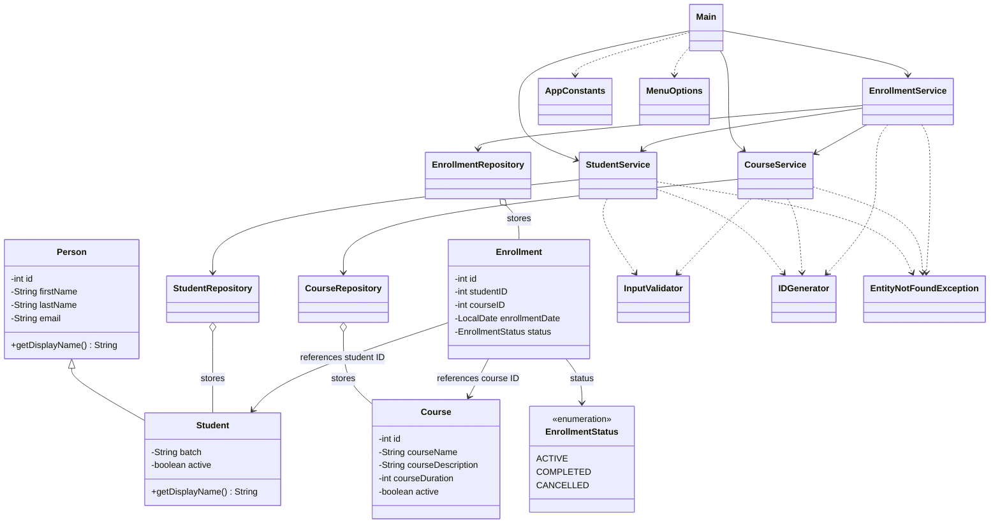

# LearnTrack

LearnTrack is my Core Java project as a part of Airtribe's FDE Course for managing students, courses and enrollments from the terminal. I used it to practise classes, inheritance, constructors, ArrayLists and exception handling.

Everything is stored in memory, so closing the app clears the records and resets the IDs.

## What you can do

- Add students, update their details, find them by ID and deactivate them.
- Add courses, look them up and activate or deactivate them. Course duration is in weeks.
- Enroll a student in a course, view their enrollments with course names and mark an enrollment as completed or cancelled.

The app generates IDs automatically. It also checks required fields and handles invalid menu input without crashing.

## Running the project

You need **JDK 21 or newer**. I used IntelliJ with JDK 24; the code also works with JDK 21.

### In IntelliJ

1. Open the `LearnTrack` folder.
2. Go to **File > Project Structure** and select your JDK as the Project SDK.
3. Make sure `src` is marked as **Sources Root**.
4. Open `src/com/airtribe/learntrack/Main.java` and click the green arrow next to `main`.

### From the Mac terminal

Open a terminal in the project folder and run:

```sh
sh run.sh
```

To compile and run it yourself:

```sh
mkdir -p out
find src -name '*.java' -print > out/sources.txt
javac --release 21 -d out @out/sources.txt
java -cp out com.airtribe.learntrack.Main
```

The `out` folder holds the compiled files. Java creates these from the source code; they aren't files you need to edit.

## Trying it out

Start by adding a student and a course. Note their IDs, then use those IDs to create an enrollment. You can view that student's enrollments and use the enrollment ID to complete or cancel one.

A few rules to keep in mind:

- Required details cannot be blank. Email is optional, but if entered, it gets a basic format check.
- Course duration must be greater than zero.
- Both the student and course must be active when you enroll.
- A student cannot have two active enrollments in the same course.
- Completed and cancelled enrollments stay in the history and cannot change status again. You can create a new enrollment afterwards.
- Deactivating a student or course keeps their records and enrollment history.

## Project structure

```text
src/com/airtribe/learntrack/
  Main.java
  entity/       Person, Student, Course, Enrollment
  repository/   StudentRepository, CourseRepository, EnrollmentRepository
  service/      StudentService, CourseService, EnrollmentService
  exception/    EntityNotFoundException
  util/         IDGenerator, InputValidator
  constants/    AppConstants, MenuOptions
  enums/        EnrollmentStatus
docs/
tests/com/airtribe/learntrack/LearnTrackFlowTest.java
```

`Main` handles the menus and user input. The entity classes hold the data, the repositories store it in ArrayLists, and the services handle validation and rules such as whether a student can enroll.

`Student` extends `Person` to reuse the name, email and ID fields. `Enrollment` connects a student and a course using their IDs.

## Class diagram


